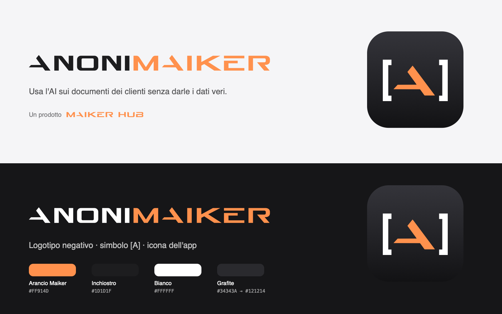

# Marchio AnoniMaiker

AnoniMaiker è un prodotto **MaikerHub** e ne riprende il marchio.

- **«MAIKER»** usa le lettere originali del logo MaikerHub, nel suo arancio.
- **«ANONI»** è disegnato nello stesso stile, con le stesse proporzioni. Riprende le diagonali della M, i raccordi
  della U e la A e la I originali.

## File

| File | Uso |
|---|---|
| `anonimaiker-logotipo.svg` | Logotipo principale, su fondi chiari: «ANONI» inchiostro, «MAIKER» arancio |
| `anonimaiker-logotipo-negativo.svg` | Su fondi scuri: «ANONI» bianco, «MAIKER» arancio |
| `anonimaiker-logotipo-arancio.svg` | Monocromo arancio, per usi a un colore |
| `anonimaiker-simbolo.svg` | Il simbolo, cioè un segnaposto `[A]` con la A di MaikerHub: icona, avatar, favicon |
| `maikerhub-logotipo.svg` | Il logo MaikerHub vettoriale, per la firma «Un prodotto MaikerHub» |

L'icona dell'app sta in `App/AppIcon.icon` (Icon Composer) e usa gli stessi elementi del simbolo.

## Colori

| Nome | Valore | Dove |
|---|---|---|
| Arancio Maiker | `#FF914D` | «MAIKER», la A del simbolo, colore d'accento dell'app |
| Inchiostro | `#1D1D1F` | «ANONI» su fondi chiari |
| Bianco | `#FFFFFF` | «ANONI» su fondi scuri, le parentesi del simbolo |
| Grafite | da `#34343A` a `#121214` | Fondo dell'icona, in sfumatura dall'alto in basso |

## Regole d'uso

- **Spazio libero:** attorno al logotipo lascia almeno l'altezza della «I».
- **Dimensione minima:** 12 px di altezza a schermo. Sotto, usa il simbolo.
- **Non** cambiare i colori delle due parti. **Non** separare «ANONI» da «MAIKER», non deformarlo, non aggiungere
  ombre o contorni.
- La firma si scrive «Un prodotto MaikerHub», con il logo MaikerHub o il nome in testo.
