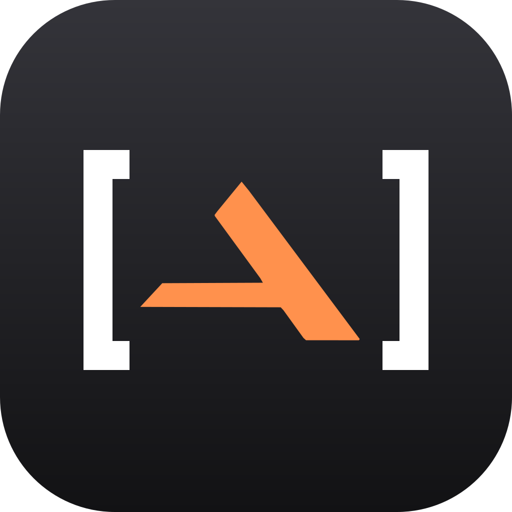

<p align="center">
  
</p>

<h1 align="center">
  <picture>
    <source media="(prefers-color-scheme: dark)" srcset="Brand/anonimaiker-logotipo-negativo.svg">
    
  </picture>
</h1>

<p align="center">
  <b>Usa l'intelligenza artificiale sui documenti dei tuoi clienti senza darle i dati veri.</b><br>
  Un prodotto <a href="Brand/README.md"></a>
</p>

<p align="center">
  <a href="https://github.com/ivanmosetti07/AnoniMaiker/releases/latest"><b>Scarica per macOS</b></a> ·
  <a href="#scaricare-e-installare">Installazione</a> ·
  <a href="#compilare-dal-codice">Compilare dal codice</a>
</p>

AnoniMaiker è un'app gratuita e open source per macOS, un prodotto MaikerHub. Anonimizza testi e file direttamente sul Mac: nomi, aziende,
codici fiscali, IBAN, email e telefoni diventano segnaposto come `[FULLNAME_1]`, `[IBAN_1]` o `[ORG_1]`. Il testo
anonimizzato si può dare a ChatGPT, Claude o a qualsiasi altra AI, e la risposta torna con i dati veri. Ha un CRM per i
clienti e una chat con GPT che usa il tuo abbonamento ChatGPT. I dati personali non lasciano mai il Mac.

```
Mario Rossi, IBAN IT60X054…   →   [FULLNAME_1], IBAN [IBAN_1]   →   AI   →   Gentile Mario Rossi, …
```

## Scaricare e installare

1. Scarica **AnoniMaiker-x.y.dmg** dall'[ultima versione](https://github.com/ivanmosetti07/AnoniMaiker/releases/latest).
2. Apri il DMG e trascina AnoniMaiker in Applicazioni.
3. La prima volta macOS dice che non può verificare l'app, perché non è notarizzata da Apple. Premi **Fine**, poi in
   Impostazioni di Sistema › Privacy e sicurezza premi **Apri comunque**. Dalla volta dopo si apre normalmente.

Requisiti: macOS 26 o successivo, Mac con Apple Silicon o Intel. Il download pesa circa 570 MB perché il motore di
anonimizzazione è dentro l'app.

Al primo avvio una **guida** spiega in pochi passi come funziona e aiuta a fare le prime cose: la copia di sicurezza, il
primo progetto, il primo file, la chat. Si riapre da Aiuto › Guida di AnoniMaiker.

**Aggiornamenti:** quando esce una nuova versione, l'app lo dice e la installa con un clic. Installa solo DMG firmati con
la chiave del progetto, e i tuoi dati restano dove sono.

**Chat con GPT (facoltativa):** ognuno collega il proprio abbonamento ChatGPT con il pulsante **Collega il tuo account
ChatGPT** (nella chat o in Impostazioni › Chat). L'accesso si fa sul sito di OpenAI e l'app non vede la password. Dietro
c'è Codex, la riga di comando di OpenAI: se manca, l'app lo installa al primo collegamento. Per farlo serve Node.js
([nodejs.org](https://nodejs.org)) oppure Homebrew.

## Cosa c'è

### Progetti

- **Si lavora per progetti.** Un cliente, un evento, una pratica. Il progetto aperto sta in cima alla barra laterale,
  e dal menu si cambia, se ne crea uno nuovo (⌘N) o si torna all'elenco (⇧⌘P).
- **Dentro un progetto:** «Anonimizza», «Riconverti» e «Documenti», poi il suo CRM (Persone, Aziende, Trattative,
  Attività) e il suo Dizionario. Le Impostazioni sono in fondo alla barra laterale.
- **I documenti si raccolgono da soli.** Un file anonimizzato nel progetto entra fra i suoi documenti, con l'originale,
  la versione anonimizzata e le versioni dell'AI. Un testo incollato si salva con «Salva nei documenti del progetto».
- **Il CRM si riempie da solo.** Le persone e le aziende trovate nei documenti entrano nel CRM del progetto. Email,
  telefono e codice fiscale sulla stessa riga di una persona sono suoi, e nome e cognome in due colonne vicine sono una
  persona sola. Chi c'è già non si duplica. Trattative e attività si aggiungono a mano.
- **Un dizionario per progetto.** I segnaposto di un progetto valgono solo lì: un file si riconverte nel progetto da cui
  viene.
- **Dalle versioni precedenti:** alla prima apertura ogni cliente diventa un progetto con le sue cose, e il resto va in
  «Generale». I segnaposto restano quelli di prima.

### Anonimizzare e riconvertire

- **Motore di anonimizzazione sul Mac.** Un modello Core ML incluso nell'app, più regole con controllo dei checksum per
  IBAN, codice fiscale, P.IVA e carte. Di serie nasconde i dati personali e le aziende. Importi, date e città restano
  in chiaro: all'AI servono per conti e confronti.
- **Dizionario cifrato, uno per progetto.** Nel progetto lo stesso dato ha sempre lo stesso segnaposto, e i suoi file si
  riconvertono da soli. Un numero cancellato non viene mai riusato.
- **File .txt e .md.** L'anonimizzazione e la riconversione mantengono codifica, BOM e a-capo dell'originale. La
  riconversione accetta anche le forme che producono le AI: grassetto, parentesi perse, Markdown con `\[` e `\_`. I
  segnaposto sconosciuti vengono segnalati.
- **Nomi dei file.** I dati del dizionario diventano segnaposto anche nel nome del file anonimizzato, e tornano veri
  in quello riconvertito.
- **Impostazioni:** categorie da nascondere, eccezioni («nascondi sempre» per i nomi che il motore non riconosce, come un'attività dal nome vago, e «mai nascondere») e dati già noti.

### CRM del progetto e copia di sicurezza

- **CRM del progetto:** persone, aziende, trattative con importo, fase e probabilità, note e attività con scadenze.
- **Scheda dell'azienda.** Ci sono panoramica, documenti, note e attività, trattative. I dati che il CRM del progetto
  conosce (ragioni sociali, P.IVA, nomi, email e telefoni delle persone) si nascondono anche dove il modello non li
  riconosce.
- **Documenti con le loro versioni:**
  - l'originale, conservato cifrato byte per byte;
  - la versione anonimizzata, da copiare o esportare per l'AI;
  - le risposte dell'AI, incollate o importate e mostrate riconvertite.
- **Scheda anonimizzata.** Anagrafica, persone, trattative, note e documenti di un'azienda in un testo pronto per l'AI.
- **Togliere un'azienda.** Persone, trattative, attività e documenti restano nel progetto, senza l'azienda. Cancellando
  un progetto se ne vanno anche i suoi documenti, il CRM, il dizionario e le conversazioni.
- **Copia di sicurezza protetta da password.** Contiene tutti i progetti, con documenti, CRM, dizionari e conversazioni, cifrati con una chiave ricavata
  dalla password (PBKDF2-SHA256, 600.000 iterazioni). Si riapre su un altro Mac. Ripristinando, i dati di prima non si
  cancellano: finiscono in «Sostituiti il …».

### CSV, Excel, Word e PDF

- **CSV ed Excel, cella per cella:**
  - il modello legge una riga intera per avere il contesto, ma i segnaposto vanno nelle singole celle;
  - le colonne riconoscibili dall'intestazione («Email», «Cognome», «P.IVA», «Telefono») si nascondono anche dove il
    modello non vede niente;
  - in Excel restano stringhe condivise, testo formattato, formule, intestazioni, piè di pagina e commenti. Un
    telefono salvato come numero diventa testo.
- **Word, con la formattazione:**
  - se un dato è spezzato fra testo normale e grassetto, il segnaposto prende la formattazione del primo pezzo;
  - si leggono anche intestazioni, piè di pagina, note, commenti, testo cancellato con le revisioni, campi e
    indirizzi dei collegamenti.
- **PDF:** si legge il testo e le pagine scansionate passano dall'OCR di Apple, sul Mac. Ne esce un PDF nuovo con
  un'impaginazione semplice.
- **Metadati e grafia:**
  - nei file anonimizzati non restano autore, società, titolo né gli autori di commenti e revisioni;
  - ogni segnaposto corrisponde a una grafia esatta: un file riconvertito torna identico, maiuscole comprese.
- **Meno falsi positivi:** quello che il modello indica come codice fiscale, IBAN, carta, targa o documento deve
  averne almeno la forma. Un dato catastale vale solo dopo «foglio», «particella», «sub.» e simili.
- **I luoghi restano luoghi:**
  - «Hotel», «Terrazza» o «Ristorante» da soli non sono aziende;
  - «Circo Massimo», «Castel Sant'Angelo» o «Borgo Pio» non sono persone;
  - una via senza numero civico («Via Cavour», «Lungotevere») è un luogo e resta in chiaro, mentre «Via Cavour 12» è un
    indirizzo e si nasconde.
- **Nel CRM** i documenti di tutti questi formati si archiviano, si anonimizzano e ricevono le risposte dell'AI,
  anche in un formato diverso, come il testo incollato.
- **Formati non gestiti:** i file .doc e .xls del vecchio Office vanno prima salvati come .docx e .xlsx.

### Chat con GPT, a destra

- **Un pannello accanto a ogni sezione** (⌘J), con le conversazioni del progetto aperto.
- **Lavora sui documenti del progetto.** GPT riceve l'elenco dei documenti con i titoli anonimizzati. Quando gli serve
  un documento scrive «LEGGI D3», e l'app gli manda il testo anonimizzato (l'ultima versione); poi continua. Lo fa per
  al massimo quattro giri.
- **Propone, tu decidi.** Le modifiche a un documento, o un documento nuovo, arrivano come schede con il testo già
  riconvertito. «Applica» ne fa una nuova versione del documento, o un documento nuovo del progetto; «Scarta» la
  lascia lì. GPT non modifica niente da solo.
- **Il modello lo scegli tu,** fra le famiglie terra, luna e sol dalla versione 6 in poi (oggi GPT-6-Sol e GPT-6-Luna),
  con il loro livello di ragionamento. Si sceglie in cima alla chat o in Impostazioni › Chat. L'elenco viene dal
  catalogo di Codex, quindi i modelli nuovi compaiono da soli.
- **Con il tuo abbonamento ChatGPT.** Ognuno collega il proprio account con un pulsante: l'app installa Codex (la riga
  di comando di OpenAI) se manca, e apre l'accesso di OpenAI nel browser. Nell'app non ci sono chiavi né password. Da
  Impostazioni › Chat si vede lo stato e si scollega l'account.
- **Parte solo quello che è anonimizzato.** Domanda, allegati, titoli e testi dei documenti e conversazione precedente
  passano dal motore di anonimizzazione con il dizionario del progetto. Senza motore la chat non parte. La risposta torna con i dati veri, e i
  segnaposto che GPT inventa si segnalano. Sotto ogni messaggio c'è «Cosa è partito» (o «Com'è arrivata») con i
  segnaposto evidenziati.
- **Allegati:** file di tutti i formati (anche trascinati), i documenti del progetto, la scheda di un'azienda.
  Anche i nomi dei file passano dal motore.
- **Grafie diverse, un solo segnaposto.** Nella chat «MARIO ROSSI» e «Mario Rossi» hanno lo stesso segnaposto, così GPT
  capisce che è la stessa persona. I file restano a grafia esatta.
- **Legata al progetto.** I dati che il CRM del progetto conosce si nascondono anche dove il motore non li vede. Una
  risposta diventa una nota del progetto con un clic.
- **Codex isolato:** niente configurazione dell'utente, niente sessioni salvate, sola lettura, niente strumenti né
  ricerca sul web, e una cartella vuota.
- **Le conversazioni** restano cifrate sul Mac, entrano nella copia di sicurezza e si esportano in Markdown con i dati
  veri.

## Pubblicare una nuova versione

Un comando fa tutto, e le app installate vedono la nuova versione e si aggiornano:

```bash
Scripts/pubblica-rilascio.sh 0.6 novita.md
```

1. Aggiorna il numero di versione.
2. Lancia i test.
3. Crea il DMG (vedi sotto).
4. Firma il DMG con la chiave degli aggiornamenti: Ed25519 sull'impronta SHA-256 del file.
5. Fa commit e tag `v0.6`, poi crea la release su GitHub con `AnoniMaiker-0.6.dmg` e `AnoniMaiker-0.6.dmg.sig`.

L'app controlla `releases/latest` all'avvio e poi una volta al giorno. Scarica il DMG e controlla la firma con la chiave
pubblica che ha dentro (`Updates.publicKey`), poi l'identificativo, la versione e la firma del codice. Infine sostituisce
l'app e la riapre. La chiave privata sta nel portachiavi di chi pubblica, alla voce «AnoniMaiker – firma
aggiornamenti». Se si perde, le app già installate non accettano più aggiornamenti automatici, quindi va conservata una
copia. Chi fa un fork genera la sua chiave con `swift run firma-rilascio genera` e cambia `Updates.repository` e
`Updates.publicKey`.

### Il DMG

L'icona è in `App/AppIcon.icon`, nel formato di Icon Composer: un foglio con un segnaposto `[•••]` al posto di una
riga. Si modifica aprendola con Icon Composer.

Un comando prepara il DMG da dare ad altri. Fa una build Release universale (Apple Silicon e Intel), la firma Developer
ID con runtime protetto, crea il DMG, lo manda alla notarizzazione Apple e lo graffa:

```bash
Scripts/distribuisci.sh
```

Il DMG finisce in `build/distribuzione/`. Prima della prima volta servono due cose:

1. **Il certificato «Developer ID Application».** Serve l'Apple Developer Program a pagamento. Si crea da Xcode ›
   Impostazioni › Account › Gestisci certificati › + › Developer ID Application.
2. **Le credenziali per la notarizzazione, nel portachiavi.** La password è una «password specifica per app» creata su
   account.apple.com:

```bash
xcrun notarytool store-credentials AnoniMaiker --apple-id <la tua email> --team-id <il tuo team>
```

Varianti:

- `--senza-notarizzare` firma senza inviare ad Apple.
- `--senza-firma` fa un DMG ad hoc, senza Apple Developer Program. Sugli altri Mac la prima apertura va confermata in
  Impostazioni di Sistema › Privacy e sicurezza › «Apri comunque». Le istruzioni sono nel file «Leggimi» dentro il
  DMG.

`Scripts/prepara-motore.sh` rende neutri i metadati del modello: nell'app il motore si chiama solo «motore di
anonimizzazione», e la licenza MIT sta in `App/Risorse/Licenze.md`.

## Struttura

| Percorso | Cosa contiene |
|---|---|
| `App/` | L'app SwiftUI: banchi «Anonimizza» e «Riconverti», dizionario, impostazioni, copia di sicurezza |
| `App/ChatView.swift`, `App/AppModel+Chat.swift` | La chat con GPT |
| `App/CRM/` | Documenti, persone, aziende e scheda dell'azienda, trattative, attività, fogli di modifica |
| `Packages/AnonymizerKit/` | Motore, cartella cifrata, copia di sicurezza, dizionario, CRM, test e la CLI `anonimizza` |
| `Packages/AnonymizerKit/Sources/AnonymizerKit/Chat/` | Client Codex, scudo della chat, conversazioni cifrate |
| `Packages/AnonymizerKit/Sources/AnonymizerKit/Documenti/` | ZIP e XML senza librerie esterne, CSV, Excel, Word, PDF (con OCR) |
| `Engine/` | Il modello compilato, il tokenizer e le etichette (620 MB, fuori da git) |
| `Scripts/prepara-motore.sh` | Mette il motore in `Engine/` (lo scarica dalla release `motore-1`) |
| `Scripts/distribuisci.sh` | Build Release, firma, DMG e notarizzazione |
| `Scripts/pubblica-rilascio.sh` | Versione, test, DMG, firma per gli aggiornamenti, release su GitHub |
| `Packages/AnonymizerKit/Sources/AnonymizerKit/Aggiornamenti/` | Controllo, verifica e installazione degli aggiornamenti |
| `App/GuideView.swift` | La guida del primo avvio |
| `App/ProjectsView.swift`, `App/AppModel+Projects.swift` | Elenco dei progetti, apertura, archiviazione dei documenti |
| `App/ChatView.swift` | La chat nel pannello a destra, con le proposte |
| `Packages/AnonymizerKit/Sources/AnonymizerKit/Progetti/` | Progetti, migrazione, CRM che si riempie dai documenti |
| `App/AppIcon.icon` | L'icona (Icon Composer) |
| `App/Risorse/Licenze.md` | Licenze di terze parti, incluse nell'app |
| `Brand/` | Logotipo, simbolo, colori e regole del marchio |

## Compilare dal codice

Servono Xcode 26 o successivo e macOS 26. Il motore (circa 560 MB) non sta in git: lo script lo scarica dalla release
[`motore-1`](https://github.com/ivanmosetti07/AnoniMaiker/releases/tag/motore-1) e ne controlla l'impronta.

```bash
Scripts/prepara-motore.sh
```

```bash
open "Anonimizzatore AI.xcodeproj"
```

Dal Terminale:

```bash
xcodebuild -project "Anonimizzatore AI.xcodeproj" -scheme "Anonimizzatore AI" -derivedDataPath build/DerivedData build
```

```bash
cd Packages/AnonymizerKit && swift test
```

```bash
cd Packages/AnonymizerKit && swift run anonimizza --motore ../../Engine "Mario Rossi, CF RSSMRA85H12F205Y"
```

Per un file stampa solo il riepilogo e la verifica della riconversione, mai il contenuto. Con `--forme` mostra la
«forma» dei dati trovati (lettere → `a`/`A`, cifre → `9`), utile per riconoscere i falsi positivi:

```bash
cd Packages/AnonymizerKit && swift run anonimizza --motore ../../Engine --file ../../clienti.xlsx --forme
```

La chat dal Terminale, con un dizionario usa e getta. Mostra cosa parte verso GPT, cosa arriva e cosa si legge
nell'app:

```bash
cd Packages/AnonymizerKit && swift run anonimizza --motore ../../Engine --chat "Scrivi un sollecito" --file ../../Esempi/offerta.md
```

I test che usano il motore vero partono solo se `Engine/` esiste.

## Dove stanno i dati

`~/Library/Application Support/Anonimizzatore AI/` contiene i dati. La cartella ha ancora il nome di prima dell'app,
così quelli già salvati restano dove sono:

- `chiave.json`: la chiave dei dati, sigillata dalla Secure Enclave e quindi utilizzabile solo su questo Mac.
- `elenco-progetti.sigillato`: i progetti.
- `progetti/<id>_dizionario`, `progetti/<id>_crm`, `progetti/<id>_chat` (`.sigillato`): dizionario, CRM ed elenco dei
  documenti, conversazioni di ogni progetto.
- `documenti/`: ogni versione di ogni documento, ciascuna in un file cifrato.

Per le prove, `ANONIMAIKER_DATI` nell'ambiente fa usare all'app un'altra cartella: i dati veri non si toccano.

Se i dati non si aprono, l'app si ferma e non li sovrascrive mai. Su un Mac nuovo si riaprono solo da una copia di
sicurezza (File › Ripristina da una copia di sicurezza…).


## Licenza

Il codice di AnoniMaiker è rilasciato con licenza [MIT](LICENSE). Il motore di anonimizzazione (pesi del modello e
pipeline di rilevamento) ha la sua licenza MIT, riportata in [App/Risorse/Licenze.md](App/Risorse/Licenze.md) e
consultabile anche dall'app.

Idee, problemi e contributi sono benvenuti nelle [issue](https://github.com/ivanmosetti07/AnoniMaiker/issues).
